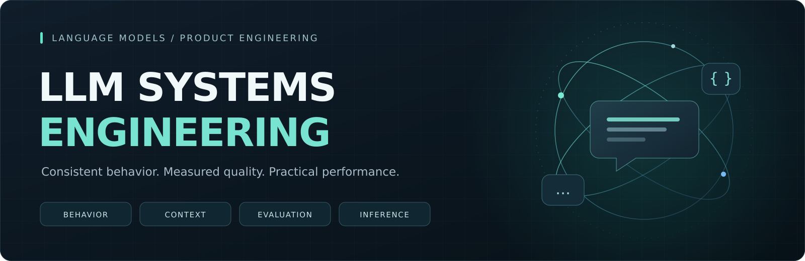

# LLM Systems Engineering

**Model behavior · Memory and context · Evaluation · Inference performance**

I develop and configure language-model systems for AI products, focusing on consistent behavior, dialogue quality, and practical inference performance. I select pre-trained models to match the task, then work on their behavior, integration, and deployment around the product's requirements.

[Discuss a project on Upwork](https://www.upwork.com/freelancers/~01d554f7011bd884f2) · [LinkedIn](https://www.linkedin.com/in/tim-izmailov-a53524283/)

## What I Work On

### Model Behavior and Dialogue Quality

Designing and refining system instructions, conversational roles, and response behavior around a product's requirements. This includes maintaining a consistent personality, handling multilingual conversations, and keeping facts and descriptions coherent across a dialogue.

### Memory and Context

Working with short-term conversational context and longer-term memory so that interactions remain consistent over time. The focus is the behavior users experience: continuity, relevant recall, and fewer contradictions.

### Model Selection and Inference

Comparing suitable language models and inference configurations against the actual task. Selecting deployment options around output quality, response latency, GPU memory, and operating cost; investigating bottlenecks and optimizing inference performance.

### Evaluation and Regression Checks

Evaluating changes through personal review, human testers, and systematic agent-based checks. Using consistent scenarios to compare behavior and identify regressions while separating application correctness from the quality of generated responses.

## My Experience and Responsibility

My experience includes sole responsibility for AI engineering within a confidential product, alongside work on another private conversational AI system. I have owned behavior requirements, model comparisons, inference tuning, quality evaluation, and coordination with product and backend development.

The engineering work extends from individual responses to how the model behaves within a larger product: what it remembers, how it maintains its role, how changes are evaluated, and how it performs within GPU constraints.

## Product Requirements I Work With

| Product need | Engineering focus |
| --- | --- |
| A conversational role stays consistent through a long exchange | System instructions, behavior refinement, and scenario-based evaluation |
| Earlier facts and preferences remain relevant later | Short-term context, longer-term memory, and continuity checks |
| Users switch languages during a conversation | Multilingual behavior and consistency of the role and remembered facts |
| Responses arrive within practical hardware and cost constraints | Model selection, GPU deployment, inference configuration, and performance analysis |
| A model or prompt change should preserve established behavior | Repeatable evaluation scenarios, human review, and agent-based regression checks |

**Areas:** Python · self-hosted LLMs · prompt engineering · conversational memory · multilingual behavior · GPU inference · model evaluation

Product identities, source code, system prompts, internal configurations, and project-specific benchmarks remain confidential.

## Illustrative Conversation

*Illustrative scenario, authored for this portfolio to show behavior requirements for a fictional game guide.*

> **User:** I'm Alex. Please keep your answers brief and don't spoil the ending.
>
> **Guide:** Got it, Alex. Short hints, no spoilers.
>
> **User:** Sigamos en español. ¿Qué te pedí al principio?
>
> **Guide:** Respuestas breves y sin revelar el final, Alex.

This example illustrates the combination of language switching, remembered preferences, and a consistent conversational role.

## Work With Me

- **LLM behavior and quality review:** investigate inconsistent responses, role drift, context problems, and quality regressions; define concrete improvement and evaluation criteria.
- **Model selection and self-hosted deployment:** compare suitable models, configure inference, and integrate the language-model component with the product.
- **Inference optimization:** investigate latency and resource use, evaluate changes, and document measured trade-offs.
- **Evaluation workflows:** establish repeatable scenarios and review processes for model or prompt changes.

A useful starting brief describes the intended behavior, representative examples of the current problem, and the product's response-time and infrastructure requirements.

[Send a project brief on Upwork](https://www.upwork.com/freelancers/~01d554f7011bd884f2) · [Connect on LinkedIn](https://www.linkedin.com/in/tim-izmailov-a53524283/)
