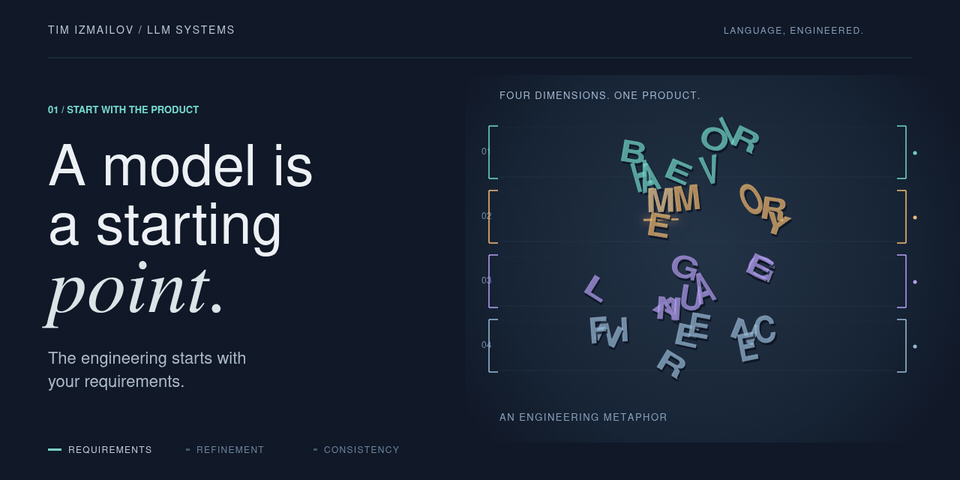
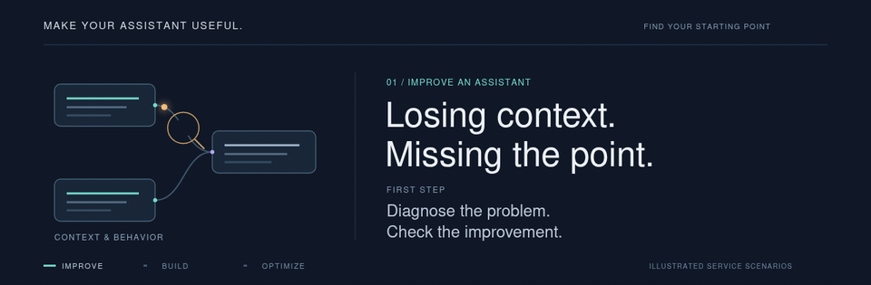
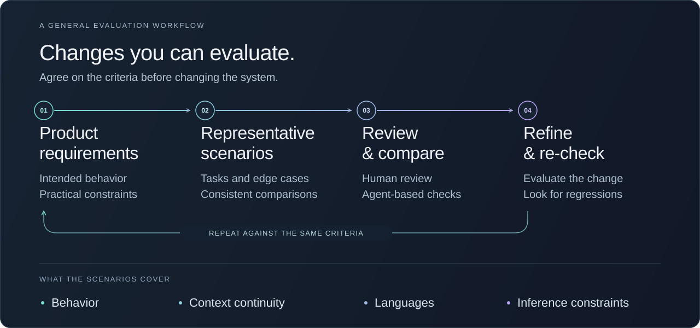

# LLM Systems Engineering

**Make your AI assistant useful for your business.**

An assistant can sound fluent while forgetting earlier details, contradicting its own answers or giving generic replies that leave the user stuck. Your team and customers end up repeating themselves instead of moving the task forward.

I diagnose these failures, refine behavior and context handling, and check improvements against representative tasks from your business. I also build LLM components and optimize inference, selecting suitable pretrained models around the product's requirements and hardware constraints.

[Improve an assistant](#improve-an-existing-assistant) · [Build an LLM component](#build-an-llm-component) · [Optimize inference](#optimize-inference)

*Conceptual illustration: shaping behavior, context and inference around a product.*

## CTO — Hands-on AI Engineering

As **CTO of a confidential AI product**, I took sole hands-on responsibility for AI engineering, including its conversational component.

The challenge was to build a consistent personality and conversational experience: coherent facts, descriptions and actions; short-term context and longer-term memory; multilingual behavior; and practical response times within GPU constraints.

I compared suitable models, developed and refined system instructions, configured inference, and designed and validated optimizations including **KV-cache reuse**. I evaluated changes personally, with human testers, and through systematic agent-based checks, while coordinating integration with backend and product teams.

This experience connects behavior design with the engineering needed to integrate, evaluate and run the model as part of a larger product.

[Improve my assistant](#improve-an-existing-assistant) · [Build my LLM component](#build-an-llm-component) · [Optimize my inference](#optimize-inference)

## Improve an Existing Assistant

For inconsistent responses, role drift, forgotten context or regressions after changes.

I investigate representative failures, refine the behavior and context handling, and establish scenarios for checking subsequent changes.

**A focused first milestone:** a clear problem definition, prioritized findings, agreed quality criteria, and a targeted improvement checked against those criteria.

## Build an LLM Component

For a product that needs a conversational role, memory, multilingual interactions or self-hosted inference.

I translate the requirements into model selection, behavior design, Python integration and deployment decisions.

**A focused first milestone:** an agreed behavior and deployment plan, followed by a working slice of the LLM component for review.

## Optimize Inference

For response latency, GPU-memory pressure or operating-cost constraints.

I investigate bottlenecks and evaluate model, deployment and inference choices, including KV-cache optimization where appropriate, while checking response quality.

**A focused first milestone:** a measured baseline, bottleneck analysis, and documented results from agreed optimization experiments.

## How Changes Are Evaluated

<strong>About the evaluation process</strong>

Representative scenarios, human review and agent-based checks support comparison and regression checks. Application correctness and generated-response quality are evaluated separately. This is a general workflow overview.

Send the intended behavior, examples of the current problem, and your infrastructure constraints. We can define a first paid milestone with clear deliverables and review criteria.

[Discuss a project on Upwork](https://www.upwork.com/freelancers/~01d554f7011bd884f2) · [Connect on LinkedIn](https://www.linkedin.com/in/tim-izmailov-a53524283/)

Product identities, source code, system prompts, internal configurations and project-specific benchmarks remain confidential.
